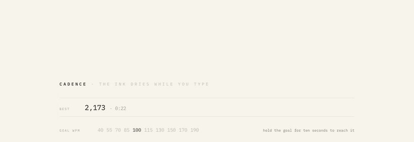

<h1 align="center">cadence</h1>

<p align="center">
  <em>A typing game for fast typists: the text dries up ahead of your caret unless you hold your goal speed.</em>
</p>

---

Pick a goal WPM and type. Keep up and the page stays readable; fall behind and the words just ahead of you fade into a blank you have to type from memory. In the balance bot, the steady 110 wpm profile lasts 184 seconds on goal (the other profiles last 16 to 133); with the goal set 10% above its speed, it is out in 28. Nothing to install, no server, no dependencies, no sound; `cadence.html` is prebuilt by `node tools/bundle.js`.

<p align="center">
  
  <br>
  <sub>A scripted run at 1.6× speed: the typist drops to about 53 wpm against a 100 wpm goal and the page dries out ahead of the caret.</sub>
</p>

**Play it:** open `cadence.html` (one self-contained file), or `index.html` from this folder. Set a goal with `←` `→`, then type any letter to begin.

```
← →       set your goal wpm      tab       restart instantly
shift+← → fine-tune goal by 5    enter     play again (result screen)
shift+T   light / dark           esc       back to the title
↓ ↑       show / hide full stats (result screen)      c   copy your score
```

## How it works

You pick a **goal WPM** from a ladder (40, 55, 70, 85, 100, 115, 130, 150, 170, 190) and the drying ink is your pacer against it. The demand eases up to your goal over ten seconds and then holds there, so the page starts drying 7 to 17 seconds into a run at every speed tested (the `fade` column below).

Keep up and it stays readable. Fall below 94% of your goal and a hole opens just past the caret, and you type across it from memory. Each keystroke lends a little ink to the characters just ahead and it decays, so typing keeps the page lit and stopping lets it go out.

Hold your goal for ten seconds and you've **reached** it: the rung is banked for good and the ladder steps up, so a run is a climb until you can't.

A typo on legible ink costs only your combo. **You can only be killed by being wrong about something you couldn't see**: three of those, or two seconds sat in the dark, and the run is over.

The run walks through eight chapters as the ladder climbs, each changing what your hands are doing: alternating hands, home row, the commonest words, short words, same-hand rolls, long words, single-hand runs, and the top row.

## Scoring

Survival is a speed question. **Rhythm**, the evenness of your keystroke intervals, is the multiplier, so two players who die at the same moment are separated by how smoothly they got there.

```
per correct character:  10 × speed × rhythm × combo
```

The result screen reprints the end of your run with each character inked at the weight of your rhythm when you struck it. Smooth stretches print dark and solid; stumbles print pale. Errors are red.

## Measured

Produced by `node tools/balance.js`, which plays the game with synthetic typists whose keystroke intervals depend on hand and finger transitions and whose error rate depends on how legible the character is. Averages over five seeds. The bot sets goals continuously, so some (206, 226) are off the in-game ladder. "On goal" sets the goal from the profile's expected speed on generated text; the speed it actually reaches comes out a little lower, which is why no profile survives the 240 s cap even on goal.

```
A - drying ink   (pressure: legibility, paced by a goal wpm)
------------------------------------------------------------
  typist                     goal    wpm   fade    hole    strike  reached   ends       ending
  metronome 200 on goal        206    192  8s    13s     15s     0.0         16s   strikes      11,271
  metronome 200 10% under      226    193  7s    9s      10s     0.0         11s   strikes       7,560
  metronome 200 10% over       185    191  10s   57s     57s     2.0 @11s    59s   strikes      44,466
  tight 150 on goal            145    139  8s    24s     35s     0.0         72s   strikes      24,277
  tight 150 10% under          159    139  7s    10s     11s     0.0         12s   strikes       4,171
  tight 150 10% over           130    139  11s   22s     27s     1.0 @11s    28s   strikes      10,344
  normal 110 on goal           111    110  9s    46s     114s    0.2 @14s   184s   strikes      38,568
  normal 110 10% under         117    110  8s    15s     21s     0.0         28s   strikes       5,835
  normal 110 10% over          101    110  13s   29s     29s     1.0 @11s    78s   strikes      16,182
  ragged 110 on goal           111    109  9s    24s     52s     0.2 @13s    74s   strikes      11,215
  ragged 110 10% under         117    107  8s    14s     17s     0.0         20s   strikes       2,825
  ragged 110 10% over          101    110  13s   31s     33s     1.0 @16s    52s   strikes       8,041
  slow 70 on goal               71     72  9s    45s     56s     0.6 @120s  133s   strikes      12,215
  slow 70 10% under             79     71  8s    12s     14s     0.0         21s   strikes       1,736
  slow 70 10% over              64     72  17s   65s     65s     2.0 @15s    76s   strikes       7,062
  (ends at 240s = survived; `reached` is levels cleared in a run)
```

In the table, "10% under" means the goal is 10% above the typist's speed, and "10% over" means it is 10% below.

What the table shows. The ink starts drying at **7 to 9 seconds whenever the goal is at or above your speed**, whatever that speed is; a goal below your speed holds it off to 10 to 17 seconds. The survivable band is narrow: a goal 10% above your speed opens a hole in 9 to 15 seconds and ends the run in 11 to 28. And a low goal does not buy safety: you reach it in 11 to 16 seconds, the ladder steps up past your speed, and the normal 110 profile then lasts 78 seconds instead of 184.

## The words

Everyday English, 960 words, held in rough frequency order. A word's position in `src/words.js` is how often it turns up, because the generator samples the front of the list more than the back. The bar is *a fast typist never has to think about it*: you cannot hold a rhythm through a word you are still reading.

An earlier pool was grown to 3,142 words for variety and started serving up `wield`, `keel`, `phantom`, `torment` and `situate`. That was a vocabulary test, not a typing game, and the fix was to shrink the pool rather than to filter it. Variety now comes from the sampler and the chapter filters.

Within that, easily typed words are favoured explicitly: `easeOf()` prices a word from the same hand-and-finger facts the typist model uses (a same finger moving to a new key is expensive, a hand-off is cheap, long words cost rhythm to hold) and candidates are scored on it. A test asserts that generated text is measurably easier than drawing from the same pool uniformly would be, so the weighting cannot quietly stop working.

Excluded on purpose: anything with a UK/US spelling split, anything capitalised in real use, anything outside 2 to 9 letters.

## Development

Tested on Node v26.4.0. No package manager or install step.

```
./tools/test.sh                  # 88 tests via node --test, no runner needed
node tools/balance.js            # play the game with synthetic typists (the table above)
node tools/profile.js --draft a  # per-frame DOM mutation counts, bucketed by run time
node tools/bundle.js             # rebuild the single-file cadence.html
python3 tools/serve.py           # dev server that refuses to cache
```

`node tools/profile.js` without `--draft a` crashes (its default still names a draft that was cut).

`src/` splits into a core (`keymap`, `words`, `generator`, `metrics`, `survival`), the game itself (`draft-a`), and the DOM layer (`render`, `rail`, `screens`, `shell`). Everything in the core is a pure function, which is why it can be tested under `node --test` without a browser.

`tools/profile.js` drives a run headlessly and counts **DOM mutations per frame** rather than CPU, because browser layout cost tracks mutations and the renderer's own compute turned out to be flat. It is what found the two scrolling bugs described at the top of `src/render.js`.

In the browser, `cadenceApp.replay(opts)` deterministically plays a scripted run and draws one frame, which is useful for seeing the game at a chosen point in its difficulty curve without waiting.

The reasoning behind the October 2026 feel pass (what changed, what it was based on, what was measured, what was tried and dropped) is in [`docs/design-rationale.md`](docs/design-rationale.md); the research behind it is in [`reports/`](reports/).

## Project structure

```
.
├── cadence.html     the whole game in one file, built by tools/bundle.js
├── index.html       the same game loading src/ directly
├── src/             core (words, generator, metrics, survival), the game (draft-a), DOM layer
├── test/            node --test suites
├── tools/           test runner, balance bot, profiler, bundler, dev server
├── docs/            design rationale, the README GIF, and design history (superpowers plans and specs)
├── reports/         research behind the October 2026 feel pass
└── research_notes/  earlier notes
```
